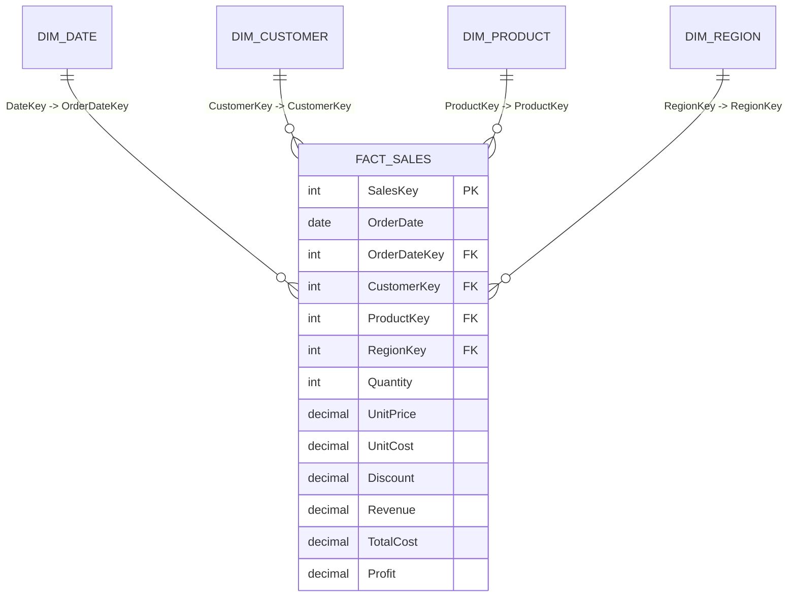

# 📊 Enterprise Sales & Executive Profitability Intelligence System (Power BI)

[](https://powerbi.microsoft.com/)
[](#)
[](#)
[](presentation/Executive_Pitch_Deck.md)

An enterprise-scale Power BI business intelligence system modeling 25,000+ multi-regional retail transactions to monitor net revenue, profit margins, and Year-over-Year (YoY) velocity without manual reporting overhead.

---

## 🎯 Executive Case Study & Pitch Deck

> 💡 **Review the Full Business Case & Strategy:**
> - 📄 **[Read the 8-Slide Executive Pitch Deck (Markdown)](presentation/Executive_Pitch_Deck.md)**
> - 🖨️ **[Printable Corporate Pitch Deck (HTML / PDF)](presentation/Executive_Pitch_Deck.html)** *(Open in Chrome/Edge &rarr; Print to PDF)*

### The Business Discovery in 60 Seconds:
- **The Challenge:** While top-line gross sales expanded by **+14% YoY**, operating margins stagnated at 21.4% due to a 48-hour manual reporting lag and discretionary promotional discounting.
- **The Solution:** Engineered an automated Power BI Star Schema connecting 25k transactions across 6 global territories with 10+ time-intelligence DAX measures.
- **The Impact:** Isolated a **6.8% margin leakage** in heavily discounted accessory lines and delivered 3 strategic recommendations projected to **recapture $285,000 in bottom-line profit**.

---

## 🏗️ Data Architecture & Star Schema



---

## 📐 Key DAX Measures Implemented

| Measure Name | DAX Expression | Business Insight |
| :--- | :--- | :--- |
| **Total Revenue** | `SUM(Fact_Sales[Revenue])` | Aggregates gross net sales |
| **Total Profit** | `[Total Revenue] - [Total Cost]` | Realized gross margin |
| **Profit Margin %** | `DIVIDE([Total Profit], [Total Revenue], 0)` | Protected zero-division margin percentage |
| **Revenue LY** | `CALCULATE([Total Revenue], SAMEPERIODLASTYEAR(Dim_Date[FullDate]))` | Historical prior-year baseline comparison |
| **YoY Revenue Growth %** | `DIVIDE([Total Revenue] - [Revenue LY], [Revenue LY], 0)` | Growth rate tracking sales velocity |
| **YoY Status Flag** | `SWITCH(TRUE(), Growth >= 0.10, "🟢", Growth >= 0, "🟡", "🔴")` | Dynamic executive KPI indicator badge |

---

## 🚀 How to Run & Inspect Locally
1. Clone this repository:
   ```bash
   git clone https://github.com/Jeet908/automated-powerbi-sales-intelligence.git
   ```
2. Open `pbix/Enterprise_Sales_Intelligence.pbix` in **Power BI Desktop** (no Microsoft organizational login required).
3. Review the presentation: Open `presentation/Executive_Pitch_Deck.html` in your browser.

---

## 👤 Author
**Sourojit Kar**  
- [GitHub Profile](https://github.com/Jeet908)
- [LinkedIn Profile](https://linkedin.com/in/sourojitkar)
