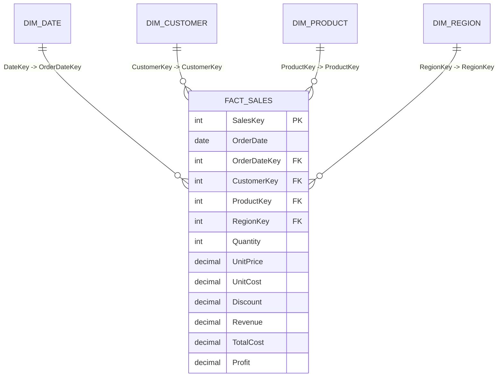

# 📊 Enterprise Sales & Executive Profitability Intelligence System (Power BI)

[](https://powerbi.microsoft.com/)
[](#)
[](#)

An automated Power BI system for tracking sales, revenue, profit margins, and year-over-year performance across 25,000+ multi-regional retail transactions, reducing reliance on manual spreadsheet reporting.

---

## 📌 Executive Summary
Traditional corporate retail reporting relies on static spreadsheets and manual refreshes that fail to reveal margin leakage. This automated system delivers:
- **Star Schema Architecture:** Seamlessly connects 1 Fact table with 4 Dimension tables (Date, Product, Customer, Region).
- **Time Intelligence DAX Engine:** Calculates real-time YoY, YTD, MTD, and margin dynamics across variable fiscal periods.
- **Automated Theming & Governance:** Standardized container styling, responsive visual hierarchy, and dynamic status badges.

---

## 🏗️ Data Architecture & Star Schema



---

## 📐 Key DAX Measures Implemented

| Measure Name | DAX Expression | Business Insight |
| :--- | :--- | :--- |
| **Total Revenue** | `SUM(Fact_Sales[Revenue])` | Aggregates gross net sales |
| **Total Profit** | `[Total Revenue] - [Total Cost]` | Realized gross margin |
| **Profit Margin %** | `DIVIDE([Total Profit], [Total Revenue], 0)` | Protected zero-division margin percentage |
| **Revenue LY** | `CALCULATE([Total Revenue], SAMEPERIODLASTYEAR(Dim_Date[FullDate]))` | Historical prior-year baseline comparison |
| **YoY Revenue Growth %** | `DIVIDE([Total Revenue] - [Revenue LY], [Revenue LY], 0)` | Growth rate tracking sales velocity |
| **YoY Status Flag** | `SWITCH(TRUE(), Growth >= 0.10, "🟢", Growth >= 0, "🟡", "🔴")` | Dynamic executive KPI indicator badge |

---

## 🚀 How to Run & Inspect Locally
1. Clone this repository:
   ```bash
   git clone https://github.com/Jeet908/automated-powerbi-sales-intelligence.git
   ```
2. Open `pbix/Enterprise_Sales_Intelligence.pbix` in **Power BI Desktop** (no Microsoft organizational login required).
3. To regenerate synthetic data:
   ```bash
   python scripts/build_project.py
   ```

---

## 👤 Author
**Sourojit Kar**  
- [GitHub Profile](https://github.com/Jeet908)
- [LinkedIn Profile](https://linkedin.com/in/sourojitkar)
