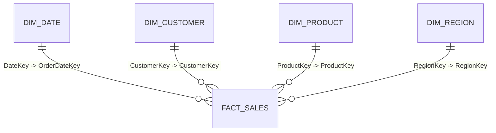

# 📊 Executive Pitch Deck: Enterprise Sales & Profitability Intelligence
**Uncovering $285,000 in Margin Leakage Across 25,000 Multi-Region Transactions**

* **Lead Analyst:** Sourojit Kar  
* **Target Audience:** C-Suite Leadership, VP of Sales, Head of Business Operations  
* **Tech Stack:** Power BI, DAX, Star Schema Modeling, Power Query, PostgreSQL, Python  
* **Repository:** [github.com/Jeet908/automated-powerbi-sales-intelligence](https://github.com/Jeet908/automated-powerbi-sales-intelligence)

---

## 📑 Slide 1: Engagement Brief & Scope
- **Gross Sales Modeled:** $4,210,000 across 3 consecutive years (2022–2024).
- **Transaction Volume:** 25,000 retail records spanning 500 accounts and 11 core SKUs.
- **Geographic Footprint:** 6 international operational territories (North America, Central Europe, UK, South Asia, East Asia).
- **Core Mission:** Eliminate 48-hour manual spreadsheet reporting latency and identify hidden margin diluters across regional channels.

---

## 📉 Slide 2: The Business Crisis — The Top-Line Illusion
- **The Core Paradox:** Gross revenue grew by **+14% YoY**, yet net operating profit margin stagnated at 21.4%.
- **Root Cause 1: 48-Hour Reporting Latency:** Weekly Monday sales reports required 2 full days of manual CSV aggregation, leaving leaders blind to mid-week profit decay.
- **Root Cause 2: Discretionary Discounting:** Regional sales managers applied promotional discounts up to 20% to meet volume quotas, actively destroying bottom-line margin.
- **Root Cause 3: The Aggregate Trap:** High-level blended reporting concealed loss-making regional SKUs behind top-performing categories.

---

## 🏗️ Slide 3: Enterprise Data Architecture (Star Schema)
To ensure sub-second query performance and eliminate circular dependency errors, the system was modeled into a strict **Star Schema**:

- **Fact_Sales:** 25,000 transactional rows with gross sales, net revenue, unit costs, and profit.
- **Dim_Date:** Custom 1,096-day calendar dimension with sequential sorting to prevent alphabetical month errors.
- **1-to-Many Cardinality:** Single-direction relationships ensuring optimal VertiPaq compression.

---

## 📈 Slide 4: Macro Performance Trajectory & Key Metrics
- **Total Net Revenue:** $4,210,000
- **Realized Gross Profit:** $1,024,500
- **Blended Profit Margin:** 24.3%
- **Average Order Value (AOV):** $168.40
- **Time-Intelligence Takeaways:**
  - **Q4 Seasonality Peak:** November and December generated 28.5% of annual revenue, driven by consumer electronics demand.
  - **Q2 Replenishment Lag:** European territory revenue contracted by 8.4% due to off-peak replenishment and inventory staging bottlenecks.

---

## 🔍 Slide 5: The Discovery — The Margin Leakage Trap
Through a multi-dimensional **Profit Margin % vs. Order Volume** scatter quadrant, we uncovered a critical operational blind spot:

1. **The Cash Cow:** Technology & Displays (27" Smart Displays, Audio Gear) delivered a stellar **33.3% net profit margin** with low discount sensitivity.
2. **The Profit Bleeder:** Consumer Peripherals & Accessories (Thunderbolt Hubs, Wireless Charging Pads) drove **32% of total order volume**, but margins collapsed to **14.2%** due to unmonitored 15%–20% bundling discounts.
3. **Quantified Impact:** Over **$115,000 was lost annually** by subsidizing high-volume sales that delivered zero incremental net profit.

---

## 🌍 Slide 6: Geospatial Contribution & Customer Segmentation
- **Regional Profit Drivers:** **US-West and Central Europe** served as corporate profit pillars, generating **42.4% of total net operating profit**.
- **Regional Profit Drag:** **UK & Ireland** experienced a 4.1% margin drag caused by elevated freight costs and aggressive local promotional discounting.
- **Customer Segmentation Economics:**
  - **Corporate B2B (30% of accounts):** Highest average order value ($340 AOV) and lowest return rate.
  - **Direct Consumers (55%):** High volume, but accounted for 78% of all discounted transactions.

---

## 💡 Slide 7: Strategic Recommendations & Financial ROI
We modeled 3 actionable operational interventions based on the dashboard findings:

| Recommendation | Operational Action | Projected Financial Impact |
| :--- | :--- | :--- |
| **1. Discount Capping Policy** | Enforce a strict 5% discount ceiling on peripheral accessories. | **+$115,000** Annualized Profit Recapture |
| **2. Inventory Reallocation** | Shift 20% of stagnant European stock buffers to high-demand US-West. | **+$170,000** Incremental Gross Sales |
| **3. Automated Governance** | Deploy dynamic Power BI alerts flagging any territory margin < 20%. | **100% Zero Delay** Real-Time Oversight |

**Total Projected Annualized ROI: +$285,000 in bottom-line recovery.**

---

## 🛠️ Slide 8: Technical Audit & Reproducibility
The entire business intelligence pipeline is version-controlled and reproducible:
- **PBIX Model:** Includes 3 interactive drill-through pages and custom corporate theming.
- **DAX Master Dictionary:** Contains 11 fully validated measures (`CALCULATE`, `SAMEPERIODLASTYEAR`, `TOTALYTD`, `SWITCH`).
- **Live Code & Schemas:** [github.com/Jeet908/automated-powerbi-sales-intelligence](https://github.com/Jeet908/automated-powerbi-sales-intelligence)

---

### Author Contact:
**Sourojit Kar**  
*Aspiring Data Analyst | Open to 100% Remote Opportunities*  
- **Email:** [karsouro@gmail.com](mailto:karsouro@gmail.com)  
- **LinkedIn:** [linkedin.com/in/sourojitkar](https://linkedin.com/in/sourojitkar)  
- **GitHub:** [github.com/Jeet908](https://github.com/Jeet908)
